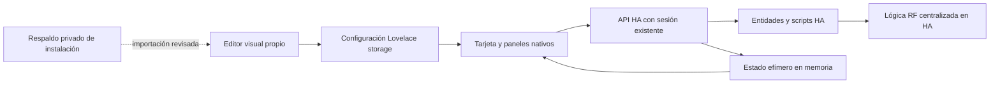

# Arquitectura de software

El navegador no se conecta al repositorio privado ni incorpora credenciales. La publicación solo incluye módulos genéricos y recursos aprobados. Browser Mod no forma parte del grafo.

## Límites V1

Edición administrativa desde el editor Lovelace, dashboard `storage`, un editor a la vez. El guardado nativo reemplaza el documento completo y no dispone de comparación atómica de revisión. Se deben detectar cambios externos, conservar borradores y solicitar recarga antes de sobrescribir cuando se detecten; queda una carrera residual documentada.

La selección o validación de una vinculación no ejecuta acciones. El control en ejecución respeta los permisos que Home Assistant aplique a la sesión. La lista de acciones admitidas por el producto reduce su superficie; no crea una frontera de autorización nueva dentro de HA.

Un backend Python solo se considerará con una necesidad demostrada que no resuelva esta vía y mediante una nueva decisión. No se incluye en esta fundación.
