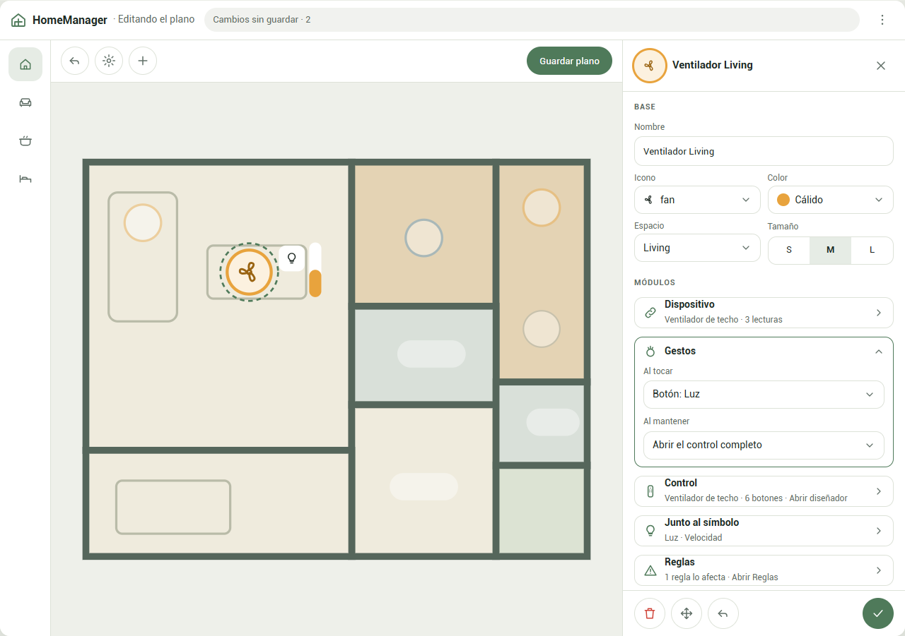
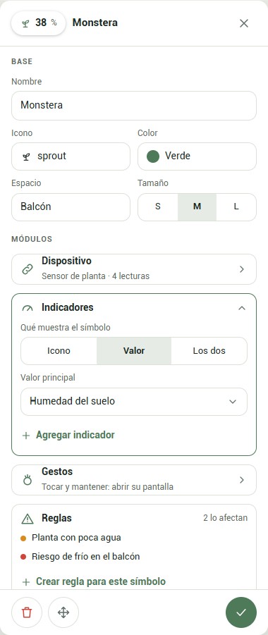
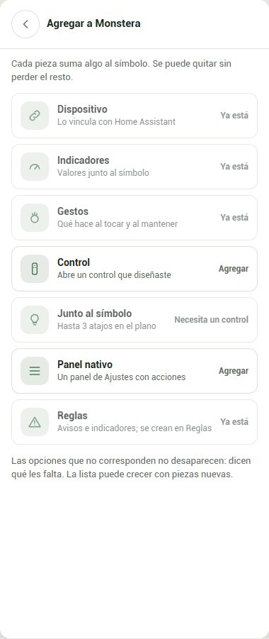
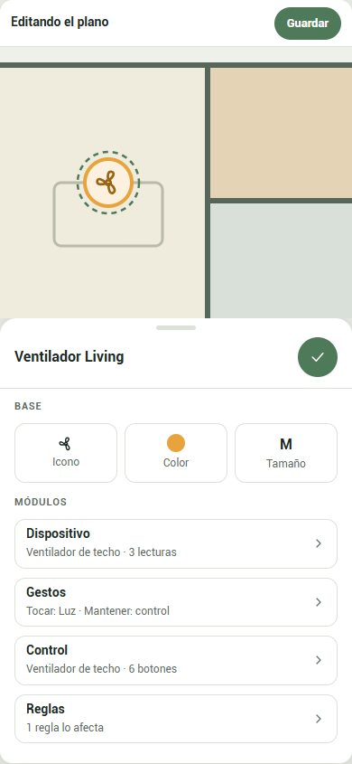
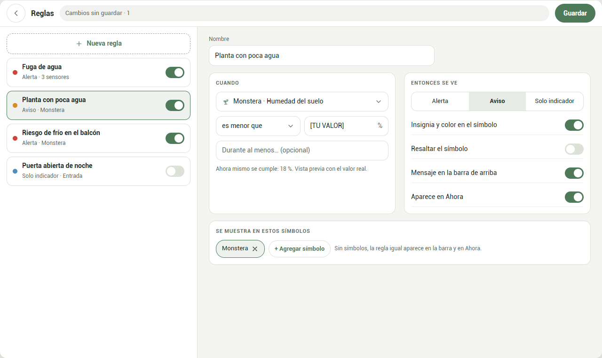
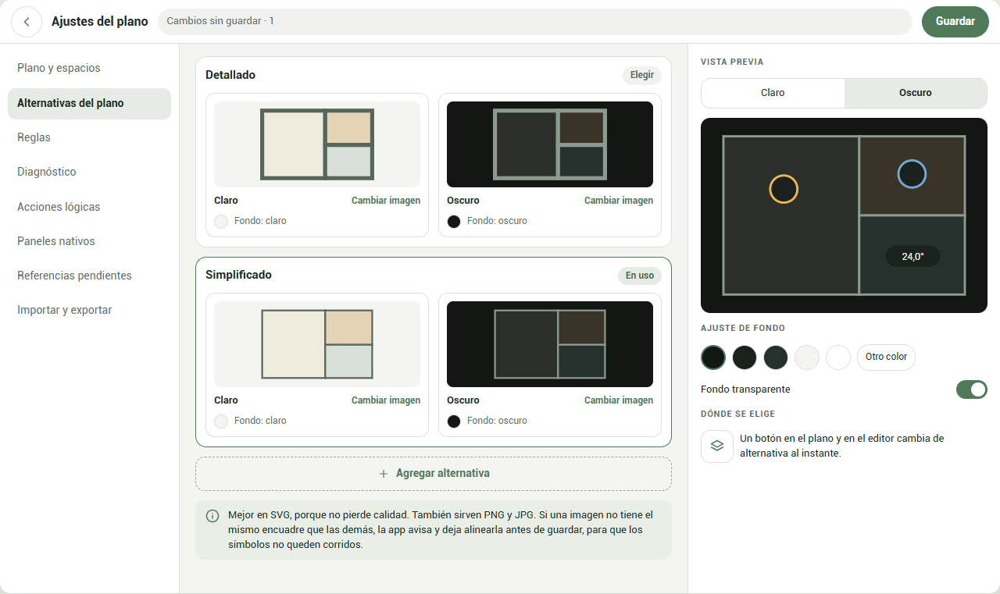

# Maqueta de módulos

Los mismos dibujos de [maqueta-modulos.html](maqueta-modulos.html), como imágenes, para verlos sin abrir un archivo local. Datos inventados.

Elegir este diseño define cómo se usa y cómo se ve. No autoriza a quitar funciones que ya existen. Donde choque con las secciones 3 y 12 de [vision-mockup.html](../vision-mockup.html), manda esta maqueta.

## 1 · Ficha lateral: un ventilador

La ficha va a la derecha, sin tapar el plano. Arriba la base; debajo, los módulos. Módulo abierto: Gestos. La ficha se desplaza: más abajo están **+ Agregar** y **Más opciones**.

## 2 · La misma ficha: un sensor de planta

La misma estructura con otras piezas. No hay interruptores fijos de aviso: las reglas se crean en su pantalla y aquí sólo se listan.

## 3 · Agregar un módulo

Cualquier símbolo puede sumar cualquier pieza. Lo que no aplica no desaparece: dice qué le falta.

## 4 · La ficha en el teléfono

Una hoja que sube desde abajo; el plano lleva el símbolo a la parte visible.

## 5 · Pantalla de Reglas

Se crean en un solo lugar. Por ahora sólo avisan e indican. `[TU VALOR]` significa que la app no propone límites fijos.

## 6 · Alternativas del plano

Cada alternativa tiene imagen clara y oscura, con su fondo, miniatura y vista previa.

