# HomeManager 0.8 · selector y nombres

Primera entrega de 0.8, [PR borrador #21](https://github.com/Delpoo/homemanager/pull/21), rama `chatgpt/0.8-picker`, desde `main` / `f2da56c`. La versión permanece en **0.7.0-beta.1**. No se publica una beta ni se cambia el CHANGELOG.

## Punto de revisión y resultado

El propietario recibió el aviso del modelo, los tres validadores y las pruebas en `4f65d5d`, antes de construir el selector: 159 pruebas JS y 125 Python de contrato/modelo aprobadas. La maqueta actualizada se abrió en navegador (§6, §7 y §8), y las reglas, 0.8/0.9 y visión §6 se releyeron antes de escribir código.

`names.ts` y `device-catalog.ts` son puros: nombre del usuario antes que el de fábrica, lecturas sin repetir el dispositivo, clases traducidas y área propia de la entidad antes que la del dispositivo. El registro de prueba tiene **15 dispositivos y 91 entidades**; un medidor de seis canales y 20 entidades produce una sola fila. Los indicadores de diagnóstico/configuración, oculto y desactivado se excluyen de los dispositivos y de todas las lecturas ofrecidas, incluidas las plegadas.

Los vínculos opcionales `deviceId` y `readings` se conservan en JS/TS/declaraciones, Python y JSON Schema. Las adicionales son hasta tres, únicas y distintas de la principal; la pertenencia se comprueba con el registro vivo, sin invalidar ni reescribir un plano si el registro cambia. [Detalles del contrato](contract.md#vínculo-opcional-al-dispositivo-08-en-revisión).

El selector muestra Todos / Sin ubicar, busca nombre/espacio/fabricante/modelo, señala En el plano, ofrece una principal ya elegida y adicionales con sus valores. Las otras lecturas se pliegan; la cuarta adicional queda deshabilitada. Buscar cualquier entidad es una pantalla avanzada separada. Un plano de 0.7 conserva sus datos y la ficha ofrece asociar el dispositivo de la entidad que ya tenía. Elegir no sobrescribe el nombre ni otros campos que se estaban editando.

Toda la presentación nueva está en `src/ui/components.ts`, con los tokens del tema y las piezas de §6. El selector no contiene `<style>`, reglas CSS ni colores literales; una prueba protege ese límite. Se conserva el resto de la ficha, como pidió el propietario. En el plano, el medidor muestra la principal y la primera adicional mientras ambas pertenezcan al dispositivo vinculado.

## Validación

| Comprobación | Resultado |
| --- | --- |
| `npm ci --ignore-scripts` | Aprobado; dependencias y versión sin cambios; cero vulnerabilidades informadas al instalar |
| `npm run check` | 163 pruebas; tipos, esquemas y límite público |
| `npm run format:check` | Aprobado |
| `npm run test:browser` | 238 aprobadas, 2 omisiones previstas de gestos táctiles en escritorio |
| `python -m pytest -q`, HA 2026.2.3 / Python 3.13 | 186 aprobadas |
| `python -m pytest -q`, HA 2026.10.4 / Python 3.14 | 186 aprobadas |
| E2E con HA 2026.2.3 temporal | 13 comprobaciones aprobadas, cero errores del bundle HomeManager |

Los tests de navegador rechazan cualquier texto visible con `_` o un identificador de entidad dentro del selector habitual, también con las lecturas plegadas abiertas. Comprueban además el límite de tres, valores que se actualizan con HA, cancelación sin cambio de borrador, vínculo de 0.7, pertenencia perdida, campos sin guardar conservados y valores dobles en el plano. Las regresiones anteriores siguen cubriendo edición, guardado, acciones, RF y planos de 0.6; no se modificó RF.

El adaptador vigila también las lecturas adicionales y los cambios de pertenencia del registro, de modo que el segundo valor del plano se actualiza sin esperar a la principal. Esa actualización sólo provoca un refresco: no puede confirmar un comando. Una prueba de adaptador y el flujo de navegador cubren esta regresión.

Las suites Python locales usan el arnés de Windows descrito en [testing.md](testing.md), con adaptación ignorada por Git para el bucle selector y sockets internos. La CI Linux ejecuta los comandos estándar. El E2E usa únicamente una configuración temporal en loopback y luces inventadas; registra separadamente cinco errores de páginas de HA ajenos a HomeManager. Ninguna prueba acciona hardware de la vivienda.

## Comparación con la maqueta

Son capturas de navegador completas a **1440×900** y **390×844** píxeles CSS. El test comprueba las dimensiones PNG y espera el color final del tema oscuro. Todas las imágenes contienen exclusivamente la casa inventada de la maqueta y el registro sintético; sus bytes revisados están fijados en `public-assets.json`.

### Selector · sección 7

| Implementación | Maqueta |
| --- | --- |
| 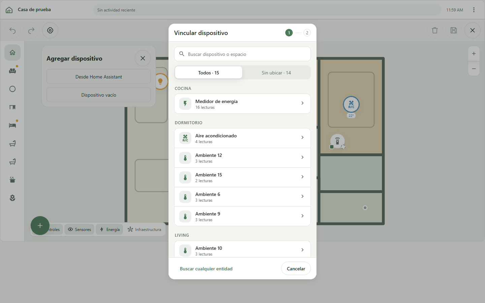 | 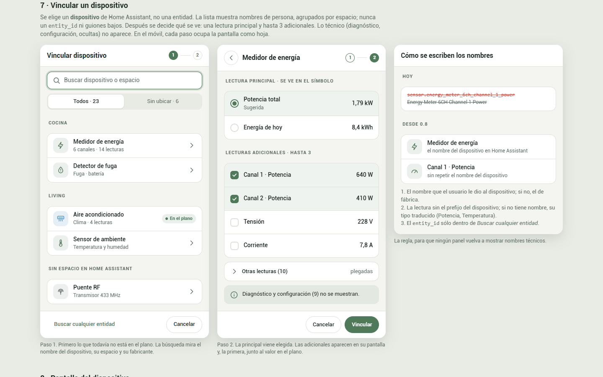 |
| 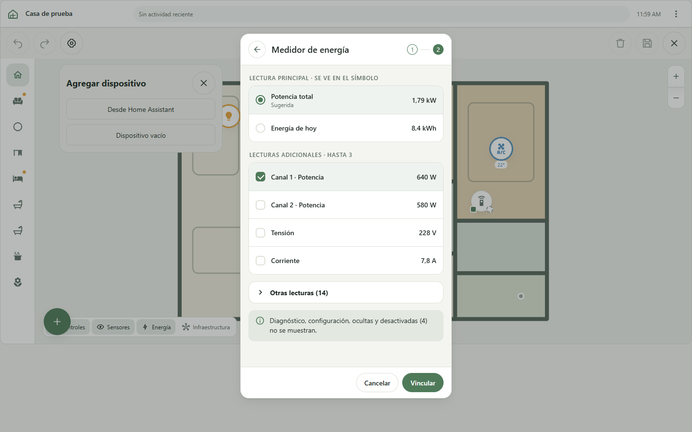 | 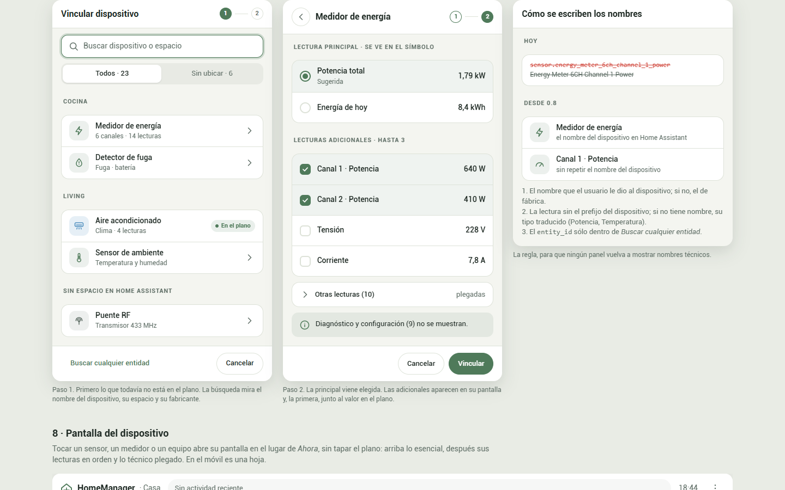 |
| 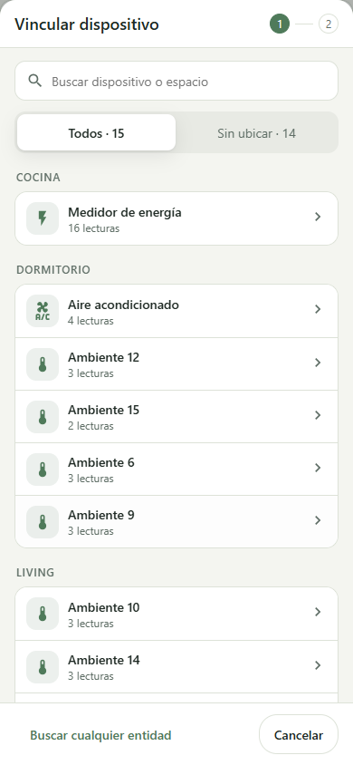 | 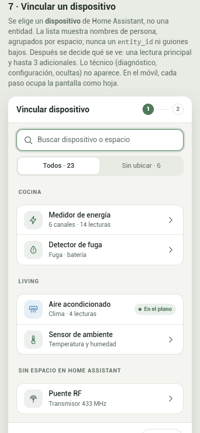 |
| 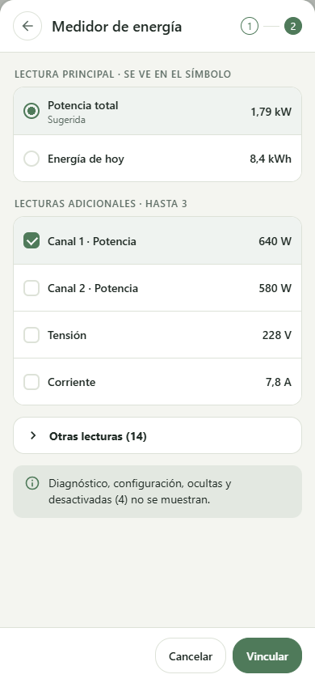 | 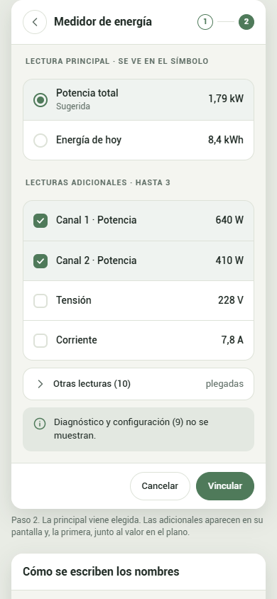 |

Diferencias: el catálogo tiene 15 dispositivos en lugar de los 23 dibujados; el medidor tiene 16 lecturas útiles y cuatro excluidas. Se muestra el número real de lecturas, sin deducir una cantidad de canales a partir de un nombre. Las sugerencias mantienen potencia total/energía de hoy y canales/tensión/corriente. Las adicionales empiezan desmarcadas hasta que la persona las elige. Los iconos son MDI reales, con la sugerencia de la entidad como respaldo. En escritorio el selector es un panel modal sobre el plano; en móvil, cada paso ocupa una hoja completa y mantiene las acciones visibles.

### Estados adicionales · componentes de sección 6

Buscar cualquier entidad y Sin resultados no tienen una vista completa dibujada en §7. Se construyeron exclusivamente con las piezas de §6; se señalan en el PR para añadir esos estados a la referencia. El componente del vínculo se muestra dentro de la ficha conservada; su rediseño integral pertenece a 0.9.

| Implementación | Referencia de componentes |
| --- | --- |
| 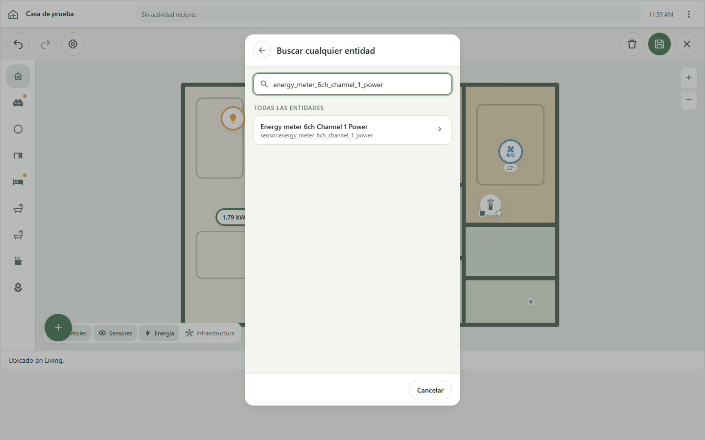 |  |
| 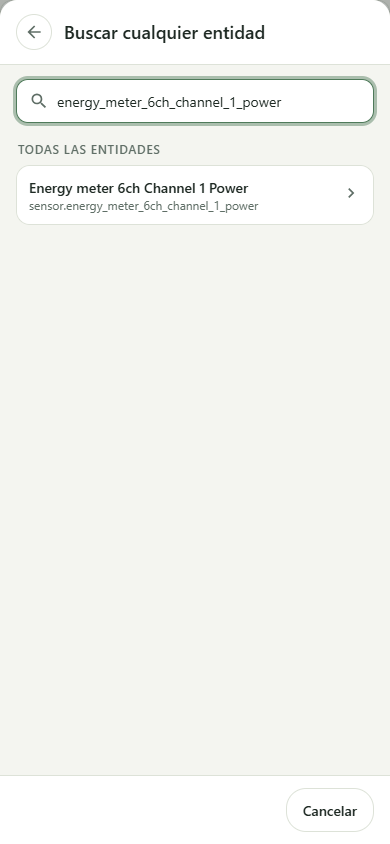 | 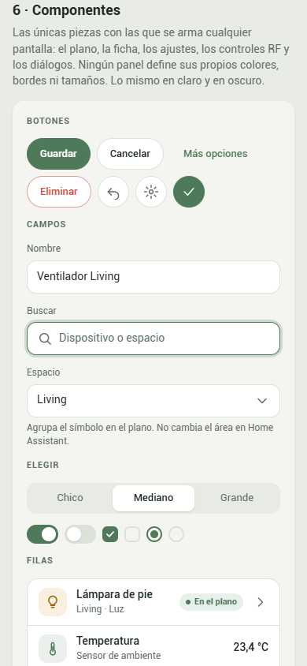 |
| 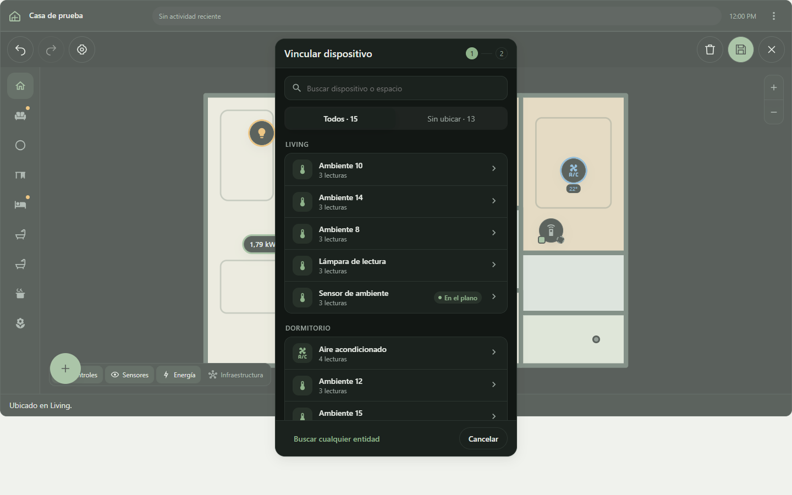 |  |
| 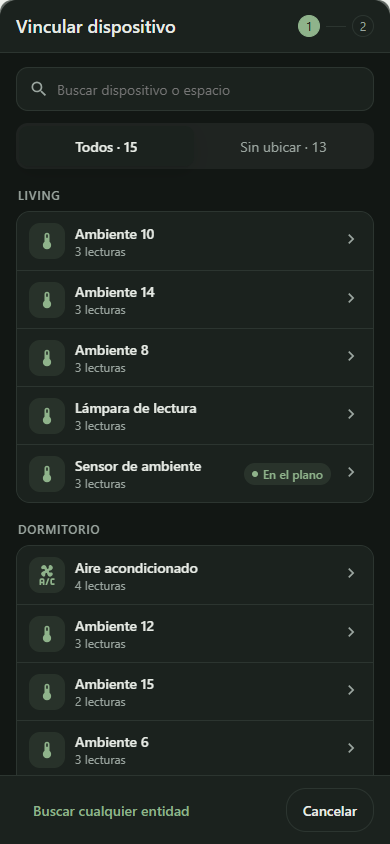 |  |
| 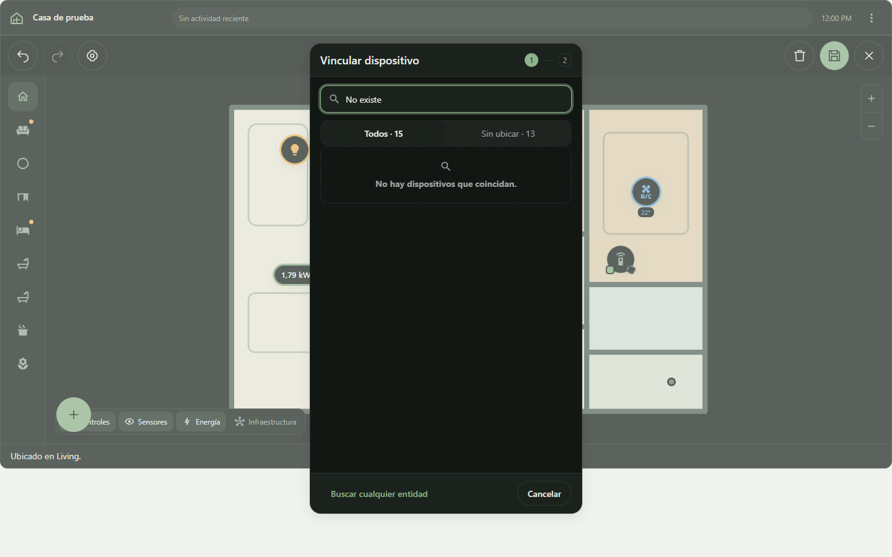 |  |
| 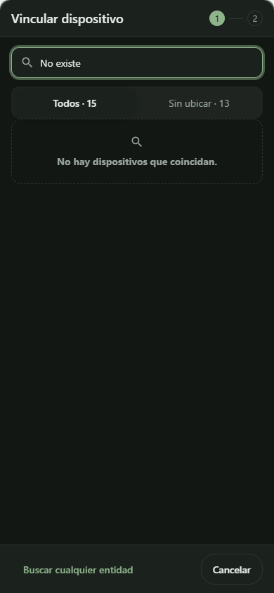 |  |
| 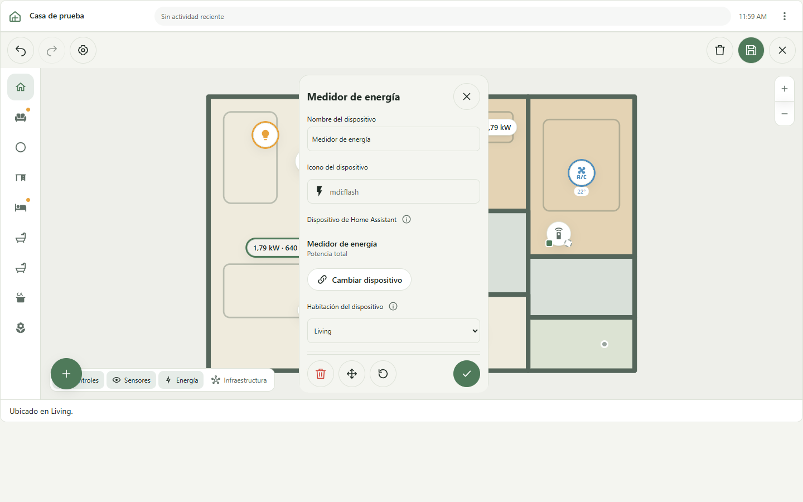 |  |
| 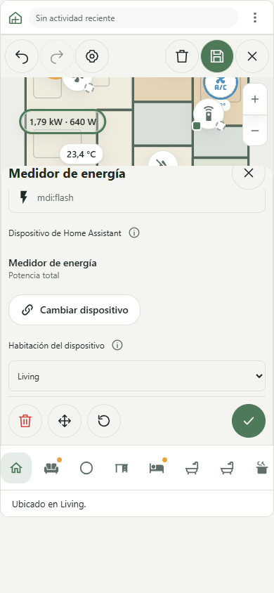 |  |

La ficha móvil está desplazada para que se vea el nuevo vínculo y su botón. Sus otros campos, estructura y restricciones se conservaron por alcance expreso.

### Primera adicional en el plano · secciones 1 y 4

| Implementación | Maqueta del panel |
| --- | --- |
| 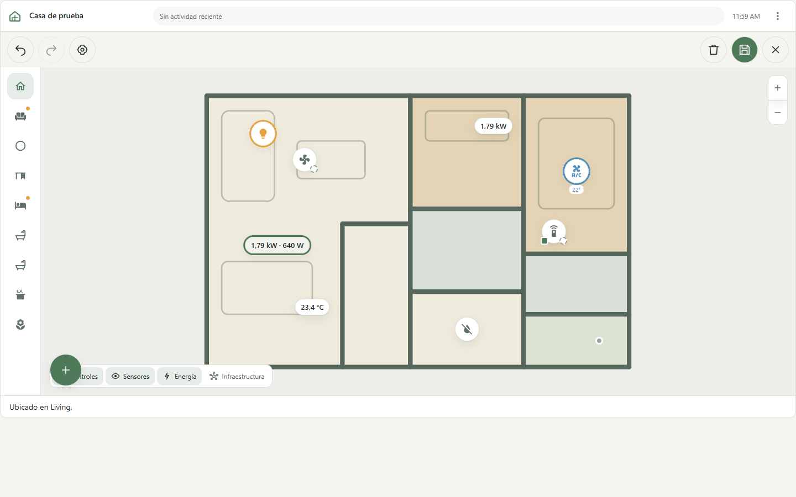 | 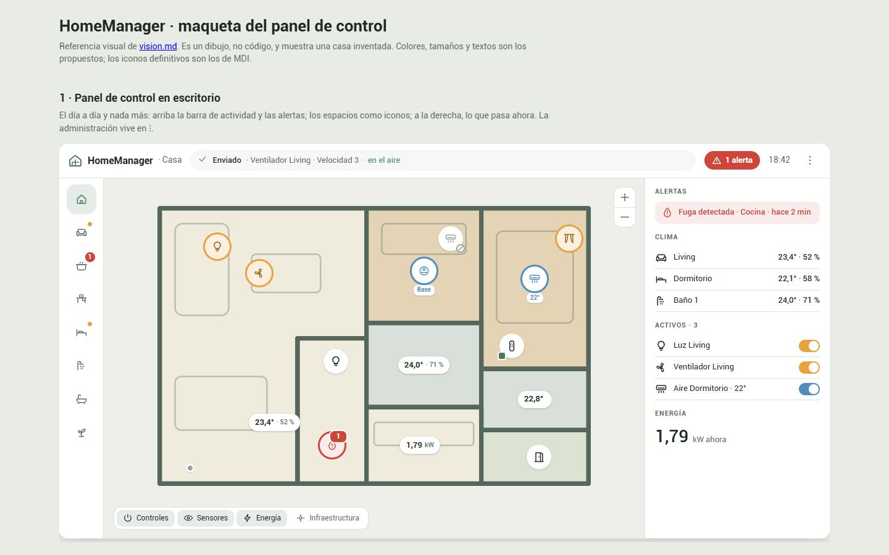 |
| 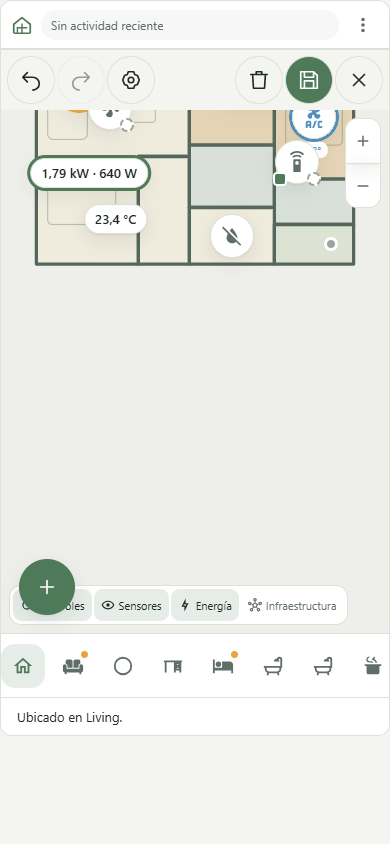 | 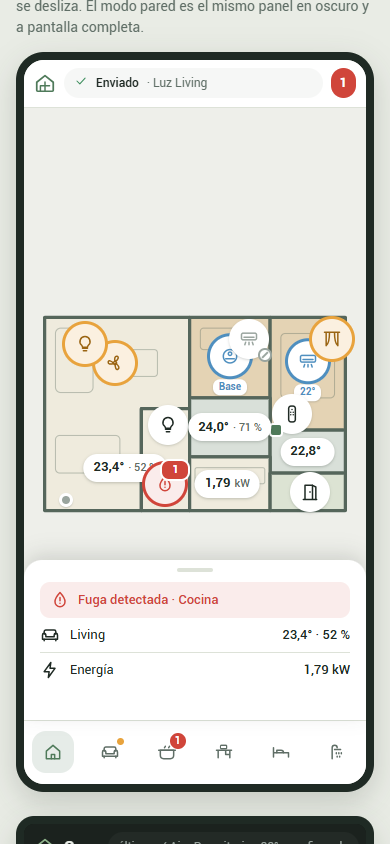 |

La columna Ahora de la referencia corresponde al segundo PR; el primero conserva el panel 0.7 y agrega el segundo valor al símbolo. Los valores siguen el formato de HA y las unidades de sus entidades. No se incorporó ninguna pantalla del dispositivo en esta entrega.

## Continuación de 0.8

El primer PR cumple los criterios del selector, nombres, exclusiones y vínculo de 0.7. **La etapa completa todavía depende del segundo PR**: pantalla del medidor con seis canales, pantalla del aire con consigna/modos y Ahora sin secciones vacías.

`chatgpt/0.8-device-screen` debe crearse desde `main` después de que el propietario fusione el primer PR. No se abrió una rama apilada ni un segundo PR sobre cambios sin fusionar. No hubo merge, release, cambios de versión/CHANGELOG, instalación real, RF, ESPHome ni rediseño adicional de la ficha.
